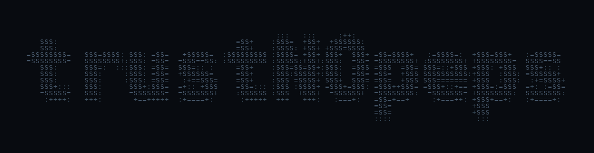

  

# Hamka / trustNOpeps

**Mechanical Engineering × Technology × Product × Creative**

I'm a mechanical engineering undergraduate at Universitas Udayana, based in Bali. I'm learning to build practical tools and thoughtful digital experiences, from engineering calculators to playful interfaces.

**[Explore the portfolio →](https://trustnopeps.github.io/trustNOpeps/)** · [View source projects](apps) · [Read selected case studies](projects)

## Featured projects

| Project | What works | Code and verification | Demo |
|---|---|---|---|
| **[MechLabs](apps/mechlabs)** | Tensile calculations, unit conversions, material comparisons, browser-local records and CSV exports | [TypeScript source](apps/mechlabs/src/lib/engineering.ts) · [Tests](apps/mechlabs/src/test/engineering.test.ts) · [CI](https://github.com/trustNOpeps/trustNOpeps/actions/workflows/mechlabs-ci.yml) | [Open app](https://mechlabs-engineering.lovable.app/) |
| **[Tensile Desk](apps/tensile-desk)** | Force–extension input validation, engineering stress–strain plotting and structured export | [JavaScript source](apps/tensile-desk/core.js) · [Tests](apps/tensile-desk/core.test.cjs) | [Open app](https://trustnopeps.github.io/trustNOpeps/apps/tensile-desk/) |
| **[Little World](apps/little-world)** | Isometric Canvas office, scripted coworker routines and local saved progress | [JavaScript source](apps/little-world/core.mjs) · [Tests](apps/little-world/core.test.mjs) | [Explore world](https://trustnopeps.github.io/trustNOpeps/apps/little-world/) |

These are independent, AI-assisted learning projects. MechLabs is an educational workbench, not certified engineering software; its GitHub source is a one-time snapshot of the Lovable project. Little World's coworkers are scripted simulations, not autonomous AI agents. Example data are labelled synthetic where used.

### More experiments

- **[Request Desk](apps/request-desk)**: local-first procurement requests with validation and CSV/JSON export. [Demo](https://trustnopeps.github.io/trustNOpeps/apps/request-desk/) · [Tests](apps/request-desk/core.test.cjs)
- **[Pixel Desk](apps/pixel-desk)**: a retro project explorer and small pixel editor with PNG export. [Demo](https://trustnopeps.github.io/trustNOpeps/apps/pixel-desk/)

The standalone JavaScript projects have a dependency-free test suite: run `npm test` from the repository root. MechLabs uses a separate Bun/Vitest workflow in [GitHub Actions](https://github.com/trustNOpeps/trustNOpeps/actions/workflows/mechlabs-ci.yml).

## Design and product explorations

I also document earlier concepts and pitch work. Prospective-client identities are intentionally withheld, and I distinguish concepts from launched work.

- [Procurement website](projects/procurement-website.md) — a specification-led catalogue and request-for-quotation flow.
- [Property company website](projects/property-company-website.md) — a company-first structure with developments organized as a project catalogue.
- [Hospitality website](projects/hospitality-website.md) — a bilingual venue pitch focused on story, menus and visiting information.

### Creative practice & writing

| Project | Status | Explore |
| --- | --- | --- |
| **[AFTER WANTING](projects/after-wanting.md)** | Seven original clothing concept volumes, 2026–27; not yet manufactured or on sale | [Editorial showroom](https://trustnopeps.github.io/trustNOpeps/showroom/) |
| **[Berpikir di Era AI](projects/berpikir-di-era-ai.md)** | Nonfiction book project; commercial manuscript kept private | [Book preview](https://trustnopeps.github.io/trustNOpeps/book/) |

These are independent, AI-assisted creative projects. The public book page is a teaser, not the full manuscript. Fashion images show concept mockups; production and rights clearance are still pending.

## How I work

**Understand the need → structure the experience → prototype → test → revise.**

My foundation is mechanical engineering. Alongside it, I'm exploring web development, UI/UX, product thinking, Git/GitHub and AI-assisted development through hands-on projects. I'm interested in the decisions behind an interface as much as its visual treatment.

---

Bali, Indonesia · Building and learning as **trustNOpeps**
