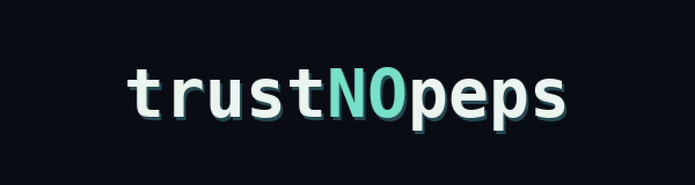

  

# Hamka

**Mechanical Engineering × Technology × Product × Creative**

I'm a mechanical engineering undergraduate at Universitas Udayana, based in Bali. I build small tools, explore digital products and learn through working prototypes. I care about clear interfaces, useful calculations and making ideas testable.

[Portfolio](https://trustnopeps.github.io/trustNOpeps/) · [Source projects](https://github.com/trustNOpeps/trustNOpeps/tree/main/apps) · [Case studies](https://github.com/trustNOpeps/trustNOpeps/tree/main/projects)

## Selected work

### MechLabs

A browser-based engineering workbench for tensile calculations, unit conversions, material comparisons, saved local records and CSV exports. Its calculations have automated tests, but the app is educational rather than certified engineering software.

[Live app](https://mechlabs-engineering.lovable.app/) · [Source](apps/mechlabs) · [Engineering tests](apps/mechlabs/src/test/engineering.test.ts) · [CI workflow](.github/workflows/mechlabs-ci.yml)

### Little World

An isometric Canvas environment with scripted coworker routines, task assignment and progress saved in the browser. The characters are simulations, not autonomous agents.

[Explore the world](https://trustnopeps.github.io/trustNOpeps/apps/little-world/) · [Source](apps/little-world) · [Tests](apps/little-world/core.test.mjs)

### Tensile Desk

A focused experiment in force and extension data, engineering stress and strain, validation, SVG plotting and structured exports.

[Try the tool](https://trustnopeps.github.io/trustNOpeps/apps/tensile-desk/) · [Source](apps/tensile-desk) · [Tests](apps/tensile-desk/core.test.cjs)

### Smaller experiments

- **[Request Desk](apps/request-desk):** A local-first procurement request editor with CSV and JSON export. [Demo](https://trustnopeps.github.io/trustNOpeps/apps/request-desk/) · [Tests](apps/request-desk/core.test.cjs)
- **[Pixel Desk](apps/pixel-desk):** A retro project explorer with a 16 × 16 pixel editor and PNG export. [Demo](https://trustnopeps.github.io/trustNOpeps/apps/pixel-desk/)

The standalone JavaScript projects include tests that can be run with `npm test` from this repository. MechLabs has its own [test and build workflow](https://github.com/trustNOpeps/trustNOpeps/actions/workflows/mechlabs-ci.yml).

## Product and design concepts

Selected work on website structure, interface decisions and client-facing proposals. Potential client identities are withheld.

- [Procurement platform](projects/procurement-website.md): Catalog structure and request-for-quotation flow.
- [Property company website](projects/property-company-website.md): Company-first website with a project catalog.
- [Hospitality concept](projects/hospitality-website.md): Bilingual website pitch for a venue.

## Creative practice

- **[AFTER WANTING](projects/after-wanting.md):** Seven clothing concept volumes. [Explore the showroom](https://trustnopeps.github.io/trustNOpeps/showroom/). Garment production and rights clearance are pending.
- **[Berpikir di Era AI](projects/berpikir-di-era-ai.md):** An Indonesian nonfiction book project. [Read the public preview](https://trustnopeps.github.io/trustNOpeps/book/). The full commercial manuscript is private.

## Approach

I usually start by understanding the problem, building a working version, checking what it actually does and refining it. These are independent, AI-assisted learning and creative projects. I distinguish prototypes from production work and use synthetic data where examples are needed.

Based in Bali, Indonesia.
