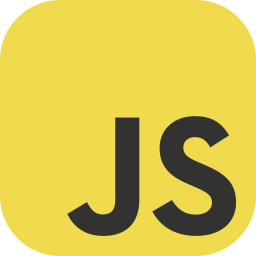
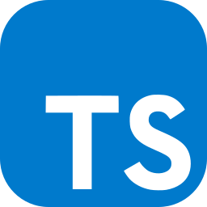
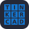

# Engineering, software and creative work

I'm haammkaki, a mechanical engineering undergraduate at Universitas Udayana in Bali. I build computational engineering tools, applied AI workflows and independent digital products, with documented methods and limitations. Creative practice includes AFTER WANTING.

**[Portfolio](https://trustnopeps.github.io/trustNOpeps/)** · [LinkedIn](https://www.linkedin.com/in/muhamad-hamka/en/)

## Selected work

My projects sit somewhere between engineering, useful software and visual experiments. The public links below lead to working tools, documented prototypes or clearly labeled concept studies.

### 01 / Engineering

**[MechLabs](https://mechlabs-engineering.lovable.app/)** · [Code](https://github.com/trustNOpeps/Mechlabs)  
An engineering workbench for stress, strain and material comparison. Educational, not certified analysis software.

**[Tensile Desk](https://trustnopeps.github.io/trustNOpeps/apps/tensile-desk/)** · [Code](https://github.com/trustNOpeps/Tensile-Desk)  
Stress and strain calculations from force and extension, with curves and CSV export. Example measurements are synthetic.

**[MachineScope](https://trustnopeps.github.io/trustNOpeps/apps/machinescope/)** · [Code](https://github.com/trustNOpeps/machinescope) · [Method & case study](projects/machinescope.md)  
Machine Intelligence: browser-local sensor CSV analysis, signal plots, RMS and transparent median/MAD anomaly detection. Synthetic demo; statistical indications, not trained AI or fault diagnosis.

**[FABFRAME](https://trustnopeps.github.io/trustNOpeps/apps/fabframe/)** · [Code](apps/fabframe/) · [Case study](projects/fabframe.md)  
Parametric CAD frame studio with cut schedules, nominal mass, stock allocation and FreeCAD/STEP exports. Includes learning exercises; no structural load rating.

**[MECH.OS — Shaft Studio](https://mech-os-shaft-studio-preview.vercel.app/)** · [Code](https://github.com/trustNOpeps/Mechlabs/tree/main/experiments/mech-os) · [Case study](projects/mech-os-shaft.md)  
Preliminary solid round shaft design: static stress, deflection, rotatable mesh and local engineering exports. Not fabrication approval.

### 02 / Applied AI & digital products

**[APPLY.OS](https://apply-os-career.vercel.app/)** · [AI Matching Lab](https://apply-os-career.vercel.app/matching/) · [Case study](projects/apply-os.md)  
Browser-local application tracking and optional multilingual Sentence-BERT matching; manual eligibility checks, not automatic applications. Source private.

**ARAH Supplies** · [Case study](projects/procurement-website.md)  
Procurement catalogue and RFQ workflow; email delivery and final client handover are outstanding.

**[ELSEWHERE](https://trustnopeps.github.io/trustNOpeps/apps/elsewhere/)** · [Code](apps/elsewhere/)  
A decision atlas for comparing options, looking at trade-offs and testing how conclusions change with different priorities.

**[BOURN](https://trustnopeps.github.io/trustNOpeps/bourn/)** · [Code](https://github.com/trustNOpeps/bourn)  
An exploratory Bali travel planning experience. Public preview, not a live concierge service.

**[Little World](https://trustnopeps.github.io/trustNOpeps/apps/little-world/)** · [Code](https://github.com/trustNOpeps/Little-World)  
A playful simulated pixel office with work orders and browser-local reports. Not autonomous AI employees.

### 03 / Creative & editorial

**[AFTER WANTING](https://trustnopeps.github.io/trustNOpeps/showroom/)** · [Project notes](projects/after-wanting.md)  
An independent clothing design archive exploring garments, stories and packaging across ten concept volumes.

**[VI Fieldnotes](https://vi-fieldnotes.pages.dev/)** · [Code](https://github.com/trustNOpeps/vi-fieldnotes)  
An independent editorial guide, with sourced articles and small reader tools.

**[Tamuform Studio](https://trustnopeps.github.io/trustNOpeps/tamuform/)** · [Case study](projects/tamuform-studio.md)  
A hospitality website and inquiry workflow pilot using fictional public examples.

More projects and case studies

* [Mechatronics Lab](https://github.com/trustNOpeps/Mechatronics-Lab)
* [Request Desk](https://trustnopeps.github.io/trustNOpeps/apps/request-desk/)
* [Pixel Pad](https://trustnopeps.github.io/trustNOpeps/apps/pixel-desk/)
* [Berpikir di Era AI](https://trustnopeps.github.io/trustNOpeps/book/)
* [Procurement website](projects/procurement-website.md), [property development](projects/property-company-website.md) and [hospitality](projects/hospitality-website.md) design studies

## Tech stack & tools

A selection of tools I use across my projects.

**Software & data**

          

**Engineering**

   

**Design & creative**

      

**Development & AI**

        

More tools and applications

**Infrastructure & development**

    

**AI research & media**

    

**Productivity & analytics**

      

[Full icon inventory and sources](assets/profile/tools/SOURCES.md)

Project notes and verification

I use AI as part of my development process. BOURN is a prototype and its authentication still needs testing. Tamuform is a pilot with fictional public previews. AFTER WANTING is at the concept stage. Engineering tools are educational and use labeled synthetic examples.

[VI Fieldnotes case study](https://github.com/trustNOpeps/vi-fieldnotes/blob/main/docs/portfolio-case-study.md) · [Tamuform notes](projects/tamuform-studio.md) · [AFTER WANTING notes](projects/after-wanting.md)

[Engineering tests](apps/mechlabs/src/test/engineering.test.ts) · [Build workflow](.github/workflows/mechlabs-ci.yml) · [Portfolio QA](docs/portfolio-design-qa.md) · [Profile maintenance](docs/profile-maintenance.md)

Open to remote work, creative collaborations and new ideas. [Connect on LinkedIn](https://www.linkedin.com/in/muhamad-hamka/en/).
