# Engineering, software and creative work

I'm haammkaki, a mechanical engineering undergraduate at Universitas Udayana in Bali. I build browser tools for engineering calculations, experiment with interactive spaces and develop clothing concepts through AFTER WANTING.

**[Explore my portfolio](https://trustnopeps.github.io/trustNOpeps/)**

## Selected projects

| Project | What you can explore | Open |
| --- | --- | --- |
| **MechLabs** | Calculate stress and strain, compare material inputs and save runs locally. | [Workbench](https://mechlabs-engineering.lovable.app/) · [Source](https://github.com/trustNOpeps/Mechlabs) |
| **Tensile Desk** | Follow a force–extension dataset from raw CSV to an engineering stress–strain curve. | [Try the synthetic example](https://trustnopeps.github.io/trustNOpeps/apps/tensile-desk/) · [Method and tests](https://github.com/trustNOpeps/Tensile-Desk) |
| **Little World** | Explore a pixel-art office by selecting desks, assigning tasks and following scripted coworkers. | [Enter the office](https://trustnopeps.github.io/trustNOpeps/apps/little-world/) · [Source](https://github.com/trustNOpeps/Little-World) |
| **AFTER WANTING** | Browse ten clothing concept collections, including garment studies with front and back views. | [Visit the showroom](https://trustnopeps.github.io/trustNOpeps/showroom/) · [Design notes](projects/after-wanting.md) |

## More work

- **[Mechatronics Lab](https://github.com/trustNOpeps/Mechatronics-Lab)** pairs an ultrasonic sensor with a servo in an Arduino simulation. The repository documents the wiring, threshold logic and limits of the virtual observations.
- **[Request Desk](https://trustnopeps.github.io/trustNOpeps/apps/request-desk/)** turns item specifications and quantities into an exportable quotation request. [Source](https://github.com/trustNOpeps/Request-Desk)
- **[Pixel Desk](https://trustnopeps.github.io/trustNOpeps/apps/pixel-desk/)** combines a searchable project gallery with a 16 × 16 drawing pad and PNG export. [Source](https://github.com/trustNOpeps/Pixel-Desk)
- **[Berpikir di Era AI](https://trustnopeps.github.io/trustNOpeps/book/)** is an Indonesian nonfiction book in development. Read the public preview.

## Product design studies

Three anonymized website concepts cover [procurement catalogues](projects/procurement-website.md), [property development](projects/property-company-website.md) and [hospitality](projects/hospitality-website.md).

## Methods and verification

My independent projects use AI-assisted development. The engineering tools are educational, with synthetic examples labeled in the interface. AFTER WANTING is at the concept stage.

Run the standalone JavaScript tests with `npm test` from this repository. MechLabs has separate [engineering tests](apps/mechlabs/src/test/engineering.test.ts) and a [build workflow](.github/workflows/mechlabs-ci.yml). The portfolio is published from `gh-pages`. [Portfolio design notes](docs/portfolio-design-qa.md)
