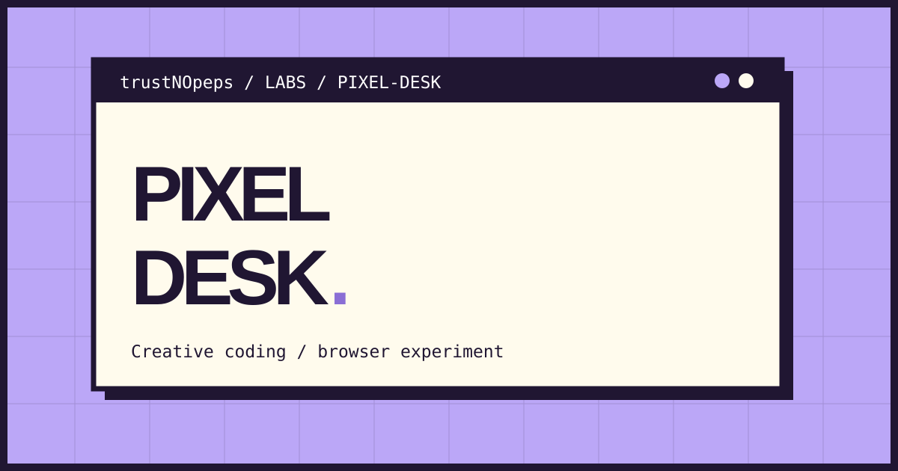

[Try live demo](https://trustnopeps-portfolio-2026.glvcmpny.chatgpt.site/apps/pixel-desk/)

# Pixel Desk

A small, colorful browser experiment by **trustNOpeps**. Retro desktop-inspired windows contain a searchable project gallery and a 16 × 16 pixel drawing pad.

## Run

Open [index.html](index.html) in a modern browser. No build tools, dependencies, account, or backend required.

## Interactions

- Filter projects by Engineering, Product or Concept; search by keyword.
- Paint by pointer input, choose between seven colors, undo up to 50 strokes, or clear.
- Export a 512 × 512 PNG postcard directly in the browser.
- Visit linked repository folders and anonymized project notes.

## Portfolio honesty

**Built** labels refer to runnable learning apps in this repository. **Concept** and **Pitch** labels refer to case-study notes, not publicly launched client products. No client identities, confidential assets, or outcome claims are used in this app.

## Implementation

Vanilla HTML, CSS and JavaScript in a self-contained file. The raster drawing is stored in an in-memory array. PNG export uses an offscreen canvas. Desktop and mobile layouts share the same content.

## Current limits

- Drawing is not persisted between sessions.
- Single-level drag gestures are grouped for Undo; no keyboard drawing controls.
- GitHub source links are not live app deployment URLs.

Created as a visual and frontend learning experiment, not production client software.
