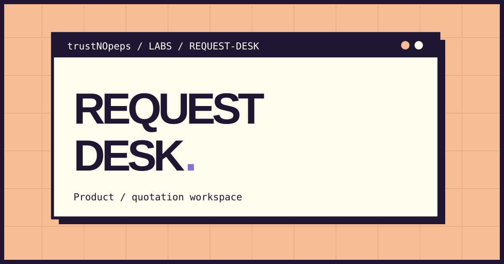

[Live demo on GitHub Pages](https://trustnopeps.github.io/trustNOpeps/apps/request-desk/)

# Request Desk

A browser workspace for turning a list of procurement needs into a structured request for quotation.

**Status:** functional learning application · HTML / CSS / JavaScript · no runtime dependencies

## Problem and approach

A supplier needs quantity, units, and specifications before providing a useful quotation. Request Desk collects those details without inventing catalogue prices or implying that an order has been placed.

## Features

- Add, edit, and remove up to 100 line items.
- Validate names, positive quantities, units, and text lengths.
- Preview a supplier-facing Indonesian request summary.
- Export quoted UTF-8 CSV or versioned JSON.
- Print the draft or use the browser's Save as PDF option.
- Count line items and distinct units without adding incompatible quantities.

## Data and security decisions

Text is inserted through `textContent`, not HTML interpolation. CSV cells are quoted and formula-like text is prefixed with an apostrophe to reduce spreadsheet formula injection. JSON uses schema version 1. There is no account, tracking, database, or automatic transmission. Drafts are held in memory; export before closing the tab.

## Boundaries

This is a local draft builder, not a supplier catalogue, checkout, email service, or procurement approval system. It does not manage stock, pricing, tax, delivery, or signed quotations. There is no JSON import or persistent draft storage in this version.

## Run locally

Download this repository with **Code → Download ZIP**, extract it, and open this folder's `index.html` in a modern browser. No installation, API key, backend, or build step is needed. GitHub's file viewer displays source code rather than running the app.

Alternatively, clone the repository:

```sh
git clone https://github.com/trustNOpeps/trustNOpeps.git
cd trustNOpeps
```

Run all calculation and export tests with Node.js 20 or later:

```sh
npm test
```

## Structure

- `index.html` — semantic interface and Indonesian labels.
- `styles.css` — responsive layout, focus states, and print styles.
- `core.js` — pure logic shared by the browser and Node tests.
- `app.js` — DOM interactions and downloads.
- `core.test.cjs` — dependency-free unit tests.

## Provenance

An independent learning project created for the **trustNOpeps** portfolio with AI-assisted implementation and documentation. This is not a commissioned client system, proof of professional engineering credentials, or evidence of commercial use.

[Back to portfolio](../../README.md)
