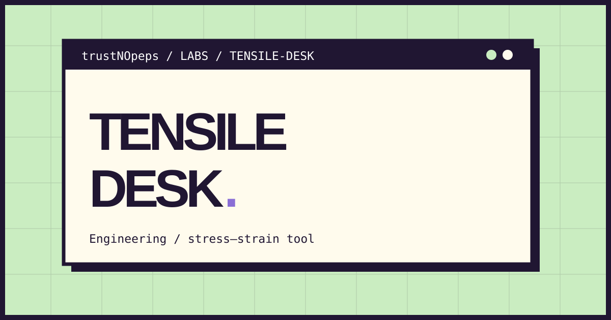

[Live demo on GitHub Pages](https://trustnopeps.github.io/trustNOpeps/apps/tensile-desk/)

# Tensile Desk

A small, local-first browser tool for converting force–extension data into engineering stress–strain values.

**Status:** functional learning application · HTML / CSS / JavaScript · no runtime dependencies

## Problem and approach

Raw force and extension measurements are hard to compare without specimen geometry. Tensile Desk keeps the original inputs visible, requires explicit units, and displays the derived values as both a curve and a table.

## Features

- Paste up to 2,000 rows of two-column CSV.
- Validate geometry, missing cells, invalid numbers, and negative inputs.
- Calculate engineering stress (MPa), strain (dimensionless), and strain (%).
- Plot points in input order, including unloading sequences.
- Export original inputs, calculated values, geometry, and data-source labels.
- Load an explicitly labelled synthetic example. Editing inputs invalidates stale results.

## Method

`stress_MPa = force_N / original_area_mm2`

`strain = extension_mm / original_length_mm`

`strain_percent = strain × 100`

Since 1 N/mm² = 1 MPa, no additional stress conversion is needed. Example: 1,000 N / 10 mm² = 100 MPa; 0.5 mm / 50 mm = 0.01 = 1%.

Reference: [OpenStax, Elasticity: Stress and Strain](https://openstax.org/books/college-physics-ap-courses-2e/pages/5-3-elasticity-stress-and-strain).

## Input contract

```csv
force_N,extension_mm
0,0
1000,0.5
```

The header is exact, decimal separators are dots, and columns use commas. Quoted fields and general-purpose CSV imports are intentionally unsupported. The parser rejects malformed rows rather than silently dropping them.

## Boundaries

This is a nonnegative tensile-data calculator using original geometry, not true stress/strain. It does not fit Young's modulus, identify yield, certify UTS, apply a test standard, or quantify uncertainty. A peak means only the maximum of the supplied data. Real laboratory use requires checking specimen measurements, instrumentation, method, and units independently. Sample data are synthetic, not experimental measurements.

No data are uploaded or persisted. Reloading clears the workspace.

## Run locally

Download this repository with **Code → Download ZIP**, extract it, and open this folder's `index.html` in a modern browser. No installation, API key, backend, or build step is needed. GitHub's file viewer displays source code rather than running the app.

Alternatively, clone the repository:

```sh
git clone https://github.com/trustNOpeps/trustNOpeps.git
cd trustNOpeps
```

Run all calculation and export tests with Node.js 20 or later:

```sh
npm test
```

## Structure

- `index.html` — semantic interface and Indonesian labels.
- `styles.css` — responsive layout, focus states, and print styles.
- `core.js` — pure logic shared by the browser and Node tests.
- `app.js` — DOM interactions and downloads.
- `core.test.cjs` — dependency-free unit tests.

## Provenance

An independent learning project created for the **trustNOpeps** portfolio with AI-assisted implementation and documentation. This is not a commissioned client system, proof of professional engineering credentials, or evidence of commercial use.

[Back to portfolio](../../README.md)
